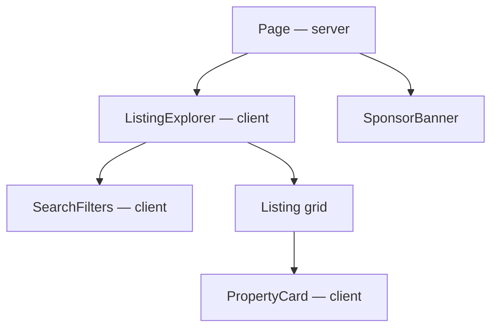

# Neighborhood Listing Platform

A neighborhood property platform for exploring featured homes,
discovering local sponsors, and presenting planned voice assistance.

## App-shell features

- Listings overview linked to featured properties.
- Neighborhood sponsors overview linked to the local partner section.
- Voice help card clearly labeled as not connected to this webpage.
- Responsive cards, semantic headings, and a keyboard skip link.
- Existing property favorites and sponsor components preserved.

Property and sponsor information on the homepage is demonstration data.

## Stack

Next.js App Router, TypeScript, Tailwind CSS, and ESLint.

## Run locally

Install dependencies:

```bash
npm ci
```

Start the development server:

```bash
npm run dev
```

Open the Local URL printed in Terminal, normally http://localhost:3000.

For an alternative port:

```bash
npm run dev -- --port 3001
```

## Verification

```bash
npm run lint
npm run build
```

Inspect the page, browser console, and terminal. Verify feature links,
the favorites toggle, keyboard navigation, and the responsive layout.

Lint and production build passed during this app-shell update.
The updated page was inspected locally at http://localhost:3001.

## Deployment

Existing project deployment:
https://neighborhood-listing-platform-mauve.vercel.app

The updated app shell was verified at this URL in Chrome Incognito
on November 25, 2026. Production Release Gates passed for merge
commit 7454382 (PR #9).

## AI collaboration

See [docs/ai-log.md](docs/ai-log.md) for prompts, the ChatGPT/Gemini
comparison, accepted and unused suggestions, and verification evidence.

## Repository hygiene

Environment files, node_modules, .next, out, build, and .vercel are
excluded through .gitignore. Never commit credentials or private data.

## Lab 2 component hierarchy



The page supplies demonstration data. ListingExplorer owns the submitted
filters and renders matching properties using stable property IDs.
SearchFilters validates selections before calling its parent's callback.
SponsorBanner preserves sponsor approval and destination URL validation.

## Lab 2 verification evidence

See [verification results](docs/lab2-verification.md) and the
[AI collaboration log](docs/ai-log.md) for testing, review decisions,
and limitations. Classmate review is required before merging the lab PR.
